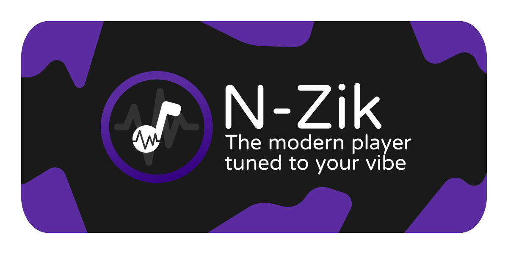
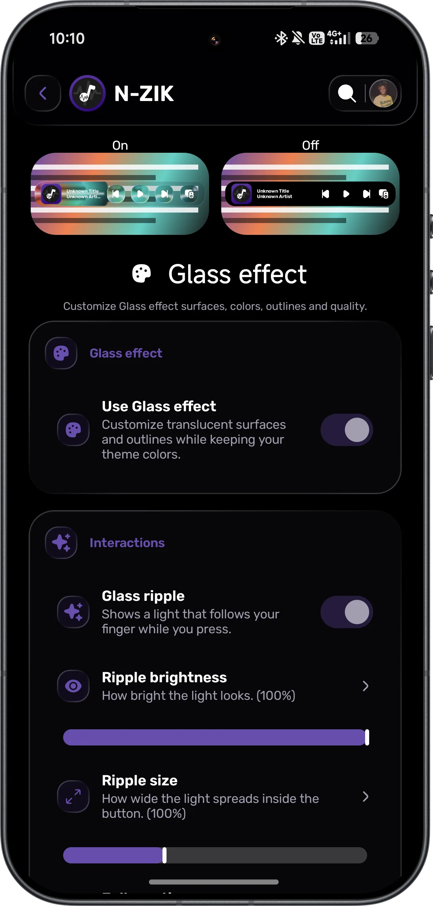
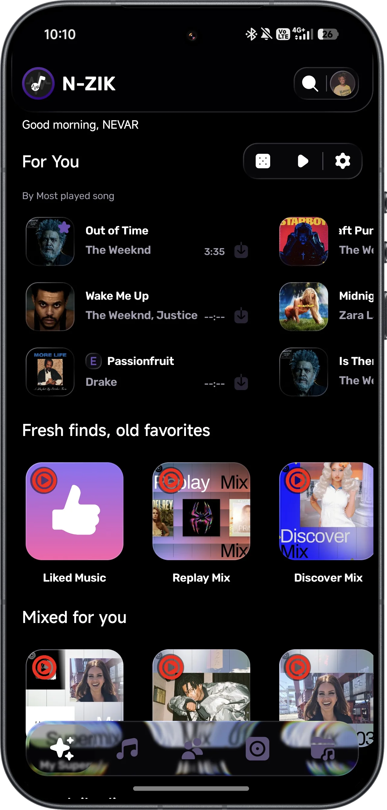
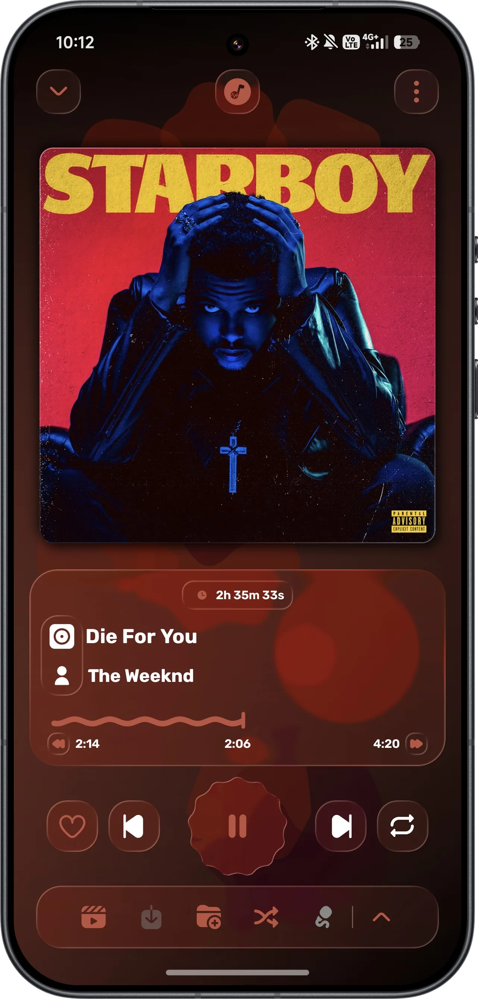
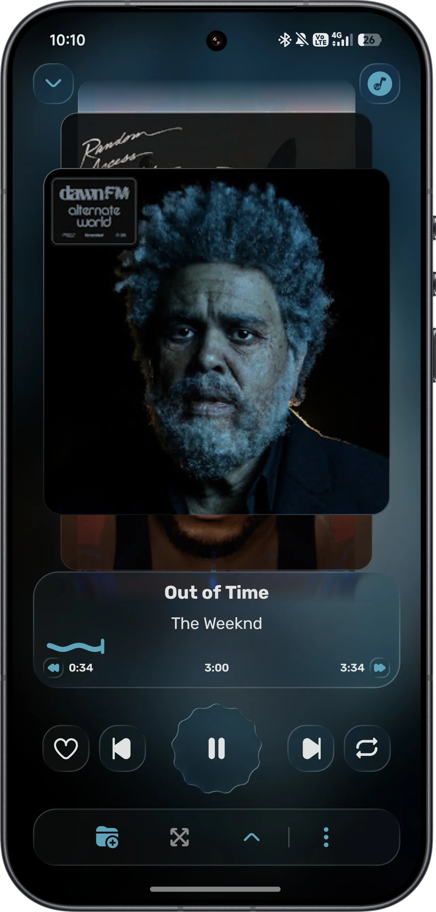

<div align="center">
  

  <h3>📱 <a href="https://github.com/N-Zik-Group/N-Zik">N-Zik App</a></h3>
  <p>
    <b>N-Zik Website</b> is the official website for <a href="https://github.com/N-Zik-Group/N-Zik">N-Zik</a>,
    the multilingual YouTube Music streaming app, hosted at
    <a href="https://n-zik.vercel.app/">n-zik.vercel.app</a>.
  </p>
  <p>
    A desktop companion is available: <a href="https://github.com/N-Zik-Group/N-Zik-Desktop-Compagnon">N-Zik Desktop Compagnon</a>
    for Windows and Linux - pair it with your phone over local Wi-Fi (QR code or manual code),
    then browse your library, manage the queue and listen on a large screen while your phone
    streams the audio through an embedded VLC, no VLC install needed. The phone stays the
    single source of truth, and the companion is a transitional product on the way to the
    standalone N-Zik desktop app.
  </p>
  <p>
    <strong>Note:</strong> This project is based on the website from
    <a href="https://github.com/fast4x/RiMusic">RiMusic</a>.
  </p>
  <p>
    <strong>N-Zik</strong> is a side project I originally built for myself and friends, not chasing glory.
    It's grown a bit since then, which is cool.
  </p>
  <p>
    I use generative AI to assist with code, structured with the
    <a href="https://github.com/bmad-code-org/BMAD-METHOD">BMAD Method</a>,
    but everything gets reviewed and tested before it's pushed. I'm not shipping blind.
  </p>
  <p>
    If AI-assisted development isn't your thing, no hard feelings,
    there are plenty of great alternatives.
  </p>
</div>

  <br><br>
<div align="center">
  
  [](https://www.gnu.org/licenses/gpl-3.0)
  [](https://www.codefactor.io/repository/github/n-zik-group/n-zik-website)

</div>

<div align="center">

## 📚 Wiki

[](https://deepwiki.com/N-Zik-Group/N-Zik-Website)

<br>

## 🌍 Community

Join the N-Zik Discord:

<a href="https://discord.gg/bneHC7QRje">
  
</a>

<br>

</div>

# 🎧 Features

- 🌍 **Multilingual Support**: Choose your language in the footer; resource catalogs live in `res/` with an English default source.
- 📥 **Download Hub**: Store badges for GitHub, F-Droid, IzzyOnDroid, OpenAPK, AndroidFreeware, Obtainium and Appteka.
- 🖥️ **N-Zik Desktop Compagnon** (Windows & Linux): Pair it with your phone over local Wi-Fi (QR code or manual code), then browse your library, manage the queue and listen on a large screen while your phone streams the audio through an embedded VLC, no VLC install needed. The phone stays the single source of truth.
- 🎬 **Feature Showcase**: 11 demo videos - home, Glass, lyrics, audio visualizer, rewind, songs, search, OTA updates, carrousel, artist pages and settings.
- 🎨 **Theme Presets**: Previews of the 6 visual themes the app ships with.
- 🫧 **Optional Glass Effect (BETA)**: The app keeps Glass off on fresh installations. Settings let you choose native, contour-only or Glass presentation by category and adjust rendering quality. Glass may increase rendering work and battery use; it can be lowered or disabled to suit your device.
- ⚡ **Zero Build**: Vanilla HTML/CSS/JavaScript - no framework, no build step, no dependencies.
- 📱 **Fully Responsive**: From phone to widescreen.
- 🔎 **SEO Ready**: `robots.txt`, `sitemap.xml` and semantic single-page markup.

# 🫧 Glass Effect (BETA)

Glass is optional and disabled on fresh installations. Enable it in Settings, choose native, contour-only or Glass presentation by category and adjust quality. It may increase rendering work and battery use; reduce quality or disable it if needed.

<div align="center">
  
  
  
  
  <br><br>
  <a href="videos/glass-demo.mp4">🎬 Watch the Glass demo</a>
</div>

Glass credits: [Square / Convx Project](https://github.com/Lelonio/Square) (GPL-3.0) and [Kyant0 AndroidLiquidGlass / Backdrop](https://github.com/Kyant0/AndroidLiquidGlass) (Apache-2.0).

# 🌐 Translations

## Overall

[](https://crowdin.com/project/N-Zik)

## Translation Progress

[](https://crowdin.com/project/N-Zik)

## Contributors

[](https://crowdin.com/project/N-Zik)

## 🌍 Help Translate

Want to:

- Translate into a new language?
- Improve an existing translation?
- Fix typos or inconsistencies?

Join us on Crowdin!

> ❓ Don't see your language?

[](https://crowdin.com/project/N-Zik)


---

# 🤝 Contributing

## 🛠️ Improve the Website

Pull requests are welcome!
Feel free to fix bugs, enhance features, or suggest new ideas.

# 📜 Clone the repo

Use this command to clone the repo

```
git clone -b main --single-branch https://github.com/N-Zik-Group/N-Zik-Website.git
```

Don't forget: to add a translation, create `res/values-xx/strings.xml` **and** add the language to the
footer language selector in `index.html`. The selector and resource catalogs must contain the same locale codes.

Les clés de traduction sont regroupées par domaine (`hero_`, `navigation_`, `feature_`,
`download_`, `footer_`) et référencées par les attributs `name` dans `index.html`.
Conservez les traductions partielles : les clés absentes utilisent la source anglaise.
Pour vérifier les ressources et leurs références sans dépendance supplémentaire :

```sh
python -B -m unittest discover -s tests -v
node --test tests/*.test.cjs
```

# 🫂 Acknowledgements

### 🛠 Based on / Inspired by:

- [**RiMusic**](https://github.com/fast4x/RiMusic): The website this project is based on.
- [**ViMusic**](https://github.com/vfsfitvnm/ViMusic)

### 🎨 Design & UI Contributions:

- The app's Glass adaptations draw on [**Square / Convx Project**](https://github.com/Lelonio/Square), licensed under GPL-3.0, and [**Kyant0 / AndroidLiquidGlass (Backdrop)**](https://github.com/Kyant0/AndroidLiquidGlass), whose backdrop sources are separately licensed under Apache-2.0. These credits describe the Android app's implementation, not the website's rendering.
- Current banner and logo [**OrangeZXZ**](https://github.com/OrangeZXZ), [**NEVARLeVrai**](https://github.com/NEVARLeVrai)

### 🌍 Platform & Ecosystem:

- [**Crowdin**](https://crowdin.com/): Community translation platform.
- [**Vercel**](https://vercel.com/): Hosting.

# ⚠️ Disclaimer

This project has no relation to the original author of [RiMusic](https://github.com/fast4x/RiMusic).

Furthermore, its contents are not affiliated with, funded, authorized, endorsed by, or in any way associated with YouTube, Google LLC, or any of its affiliates or subsidiaries.

Any trademarks, service marks, trade names, or other intellectual property rights used in this project remain the property of their respective owners.

Made with ❤️ by [NEVARLeVrai](https://github.com/NEVARLeVrai)
Licensed under GPLv3 - see [LICENSE](LICENSE)
